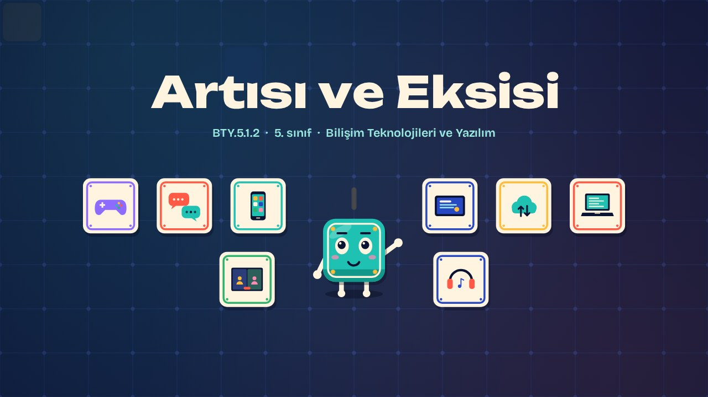
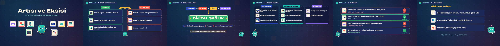

# Artısı ve Eksisi · Pluses and Minuses

**▶ Tarayıcıda izleyin / Watch in the browser:** https://hakanatas.github.io/artisi-eksisi/ 
**⬇ MP4 + altyazılar / MP4 + subtitles:** [Releases](https://github.com/hakanatas/artisi-eksisi/releases) 
**✎ Kullanılan istem / The prompt behind it:** [PROMPT.md](PROMPT.md) 
**🎞 Bütün filmler / All films:** [Bilişim Filmleri](https://hakanatas.github.io/bilisim-filmleri/?sinif=5)

> **TR —** 5. sınıf Bilişim Teknolojileri ve Yazılım dersinin "Bilişim Teknolojilerinin Hayatımızdaki Yeri" temasındaki BTY.5.1.2 öğrenme çıktısı için hazırlanmış, tamamen JavaScript ile çizilen 2,5 dakikalık animasyon; ses efektleri ve hafif fon müziği de kodla üretilir. Telefon, tablet, sosyal medya ve bulut teknolojilerinin olumlu yönleri (hızlı iletişim, bilgiye erişim) ve olumsuz yönleri (gizlilik sorunları, dijital bağımlılık, aşırı ekran süresi) bir terazinin iki kefesinde karşılaştırılır. Uzun ekran kullanımının gözler, duruş, uyku ve ruh hâli üzerindeki etkileri tanıtılır ve ergonomi kavramıyla ilişkilendirilir. Bilgisayar, telefon/tablet ve kulaklık için alınacak fiziksel güvenlik önlemleri gruplandırılır; son olarak gündelik davranışlar sağlıklı ya da riskli diye değerlendirilir. Altyazılar Türkçe, İngilizce ya da ikisi birlikte seçilebilir.

A 2.5-minute animation, with code-generated sound, for **5th-grade IT and Software** (Türkiye Yüzyılı Maarif Modeli). Phones, tablets, social media and the cloud are weighed on a balance: fast communication and access to information on one side, privacy problems, addiction and too much screen time on the other. Karo then looks at effects on eyes, posture, sleep and mood, sorts physical safety measures by device, and judges everyday habits. The guide is **Karo**, a living glazed tile who never speaks: he tells the story with his face, his arms and the blinking cursor above his head.

## Öğrenme çıktısı · Learning outcome

MEB, Türkiye Yüzyılı Maarif Modeli, Bilişim Teknolojileri ve Yazılım Dersi Öğretim Programı, 5. sınıf, 1. tema "Bilişim Teknolojilerinin Hayatımızdaki Yeri":

**BTY.5.1.2. Bilişim teknolojilerinin birey ve toplum üzerindeki etkilerini özetleyebilme**
- a) Farklı bilişim teknolojilerinin olumlu ve olumsuz yönleri ile ilgili çözümleme yapar.
- b) Farklı bilişim teknolojilerinin kullanımına göre fiziksel güvenlik önlemleri ile ilgili sınıflandırma yapar.
- c) Bilişim teknolojilerini kullanmanın beden ve ruh sağlığı üzerindeki etkilerini kendi cümleleriyle ifade eder.

## Sahneler · Scenes

| # | Zaman | Sahne | Ne oluyor | Çıktı |
|---|---|---|---|---|
| 1 | 0:00–0:17 | Giriş |  |  |
| 2 | 0:17–0:41 | Olumlu mu, olumsuz mu? | Telefon, tablet, sosyal medya ve bulutun olumlu ve olumsuz yönleri terazide. | a |
| 3 | 0:41–1:17 | Beden ve ruh sağlığı | Göz, duruş, uyku ve ruh hâline etkiler; ergonomi ve dijital sağlık. | c |
| 4 | 1:17–1:46 | Güvenlik önlemleri | Fiziksel güvenlik önlemleri bilgisayar, telefon/tablet ve kulaklık gruplarına ayrılır. | b |
| 5 | 1:46–2:16 | Sağlıklı mı? | Gündelik kullanım örnekleri sağlıklı ya da riskli diye değerlendirilir. | a, c |
| 6 | 2:16–2:32 | Aklında kalsın |  |  |

## Çalıştırma · Running it

- **Önizleme:** `index.html` dosyasına çift tıklayın (çevrim dışı da çalışır). Klavye: boşluk oynat/duraklat, ← → 3 sn, Home başa. Adrese `?altyazi=en`, `?bicim=vertical` ya da `?ses=0` eklenebilir.
- **MP4:** bir kez `npm install`, sonra `npm run export -- --format=both --captions=tr` (720p yatay ve dikey, sesli). Google Chrome yüklüyse Playwright onu kullanır (`channel: 'chrome'`); ffmpeg gerekir.
- **Altyazı ve seslendirme notları:** `npm run srt` → `out/artisi-eksisi_tr.srt`, `_en.srt`, `_tr-en.srt`, `_seslendirme-notlari.txt`.
- **Sürüm dosyaları:** `npm run release` → `release/` klasöründe v1.0'ın 6 dosyası.
- **Yazı kontrolü:** `npm run check` yatay ve dikey düzende, üç altyazı seçeneğiyle üst üste binen, kenardan taşan ya da 720p'de 17 pikselden küçük kalan yazı arar.
- **Düzenleme:** senaryo (sahneler, altyazılar, seslendirme notları) `scenes/film.js` içindedir; değiştirince `npm run build` süreleri, `captions.js` ve `film.config.js` dosyalarını yeniden üretir. Sahne şablonları `src/kit/`, Karo `src/draw/karo.js`, ses `src/audio/synth.js`.

Her kare `renderFrame(t)` ile zamanın saf fonksiyonu olarak çizilir; rastgelelik tohumludur, MP4 ekran kaydı değil kare kare üretimdir. Ses de dosyadan çalınmaz: aynı olay listesinden hesaplanır. Yazı tipleri: Unbounded ve Bricolage Grotesque (SIL OFL 1.1), dosyaya gömülü.

## Lisans · License

**TR —** Bu film ve kodu [Creative Commons Atıf-GayriTicari 4.0 Uluslararası (CC BY-NC 4.0)](https://creativecommons.org/licenses/by-nc/4.0/deed.tr) lisansıyla paylaşılır. Ticari olmayan her amaçla (derste, okulda, eğitim materyalinde) kopyalayabilir, paylaşabilir ve değiştirebilirsiniz; ancak **kaynak göstermek zorunludur**: eser sahibinin adı ve bu deponun bağlantısı belirtilmeden kullanılamaz. Ticari kullanım (satış, ücretli ürün ya da yayın) için izin alınmalıdır.

**EN —** This film and its code are licensed under [Creative Commons Attribution-NonCommercial 4.0 International (CC BY-NC 4.0)](https://creativecommons.org/licenses/by-nc/4.0/). You may copy, share and adapt them for non-commercial purposes, but **attribution is required**: they may not be used without crediting the author and linking to this repository. Commercial use requires permission.

Atıf örneği / Required credit: *“Artısı ve Eksisi”, Hakan Ataş, Bilişim Filmleri — https://github.com/hakanatas/artisi-eksisi — CC BY-NC 4.0*
